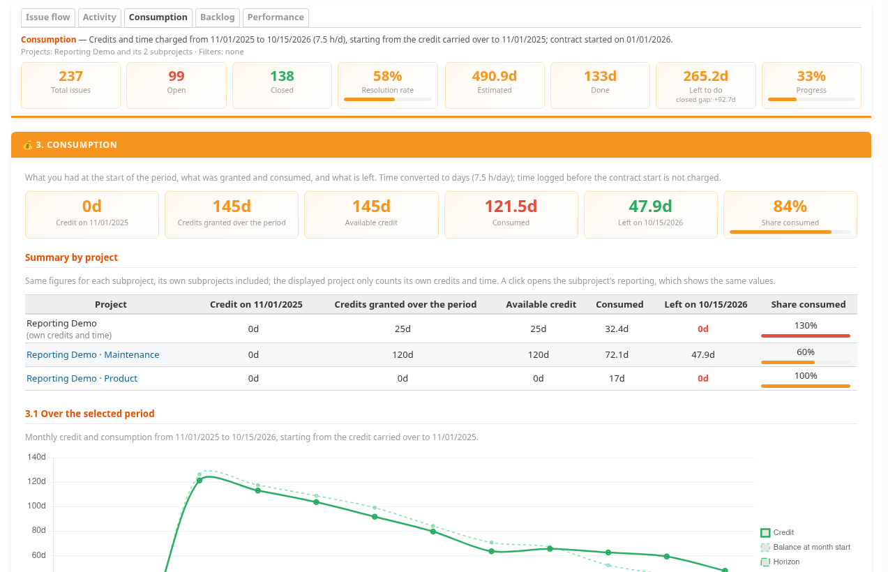

#  Redmine Reporting




Project reporting for Redmine: a dashboard of issue flow, activity, time-credit
consumption, backlog and performance, computed from Redmine's own issues and time
entries. Chart selections and linked summary figures open native Redmine lists,
with their filters, columns, sorting and exports.

Version 1.4.1 covers **Run**, **Run & Support (SLA)**, **Build & Projects** and
**Workload & Team** reports.

## Requirements

- Redmine 5.0 through 7.0, with Ruby 3.1 or later supported by that Redmine release.
  See the [compatibility matrix](test/compatibility/README.md) for the exact tested combinations.
- No external service: Chart.js 4.4.0 (MIT) is bundled with the plugin's assets.
- Optional: the redmine_sla plugin (3.0.5 or later) for the Run & Support (SLA) report.

## Installation

Source code and issue tracker: [likehopper/redmine_reporting](https://github.com/likehopper/redmine_reporting).

```sh
# Extract the plugin into /path/to/redmine/plugins/redmine_reporting first.
cd /path/to/redmine
RAILS_ENV=production bundle exec rake redmine:plugins:migrate NAME=redmine_reporting
```

Restart Redmine, then for each project (see the illustrated
[configuration guide](doc/CONFIGURATION.md) for every screen):

1. Enable the **Reporting** module (project settings, *Modules*).
2. Give roles the permissions they need:
   - *View reporting* (`view_reporting`) to open the dashboard;
   - *Configure reporting* (`manage_reporting`) for the **Reporting** settings tab and
     credit contracts.

### Upgrading

1. Back up the Redmine database and the currently installed plugin directory.
2. Read the [changelog](CHANGELOG.md) and check the exact supported combination in
   the [compatibility matrix](test/compatibility/README.md).
3. Stop the Redmine application processes, replace `plugins/redmine_reporting`
   with the new release, then run from the Redmine root:

   ```sh
   RAILS_ENV=production bundle exec rake redmine:plugins:migrate NAME=redmine_reporting
   ```

4. Restart Redmine and check the dashboard and project settings with the intended
   user roles. When upgrading a deployed application, use its normal plugin asset
   deployment procedure as well.

To return to the previous release after a schema change, restore the matching
plugin directory and database backup together. The automated matrix checks a
fresh install and uninstall/reinstall; it does not replace validation of an upgrade
against your existing data.

### Uninstalling

Uninstalling deletes the plugin's stored settings and credit contracts.
Back up the database first, stop Redmine, and run from the Redmine root while the
plugin directory is still present:

```sh
RAILS_ENV=production bundle exec rake redmine:plugins:migrate NAME=redmine_reporting VERSION=0
```

Remove `plugins/redmine_reporting`, then restart Redmine.

## The dashboard

### Run & Support (SLA)

Enable **Run & Support (SLA)** in the project settings. The family needs the redmine_sla
plugin, its module enabled on the project, at least one tracker with an SLA, and the
*View SLA* permission. It shows one block per SLA type (response, resolution…):

- **Respect by period**: delays that ended in each period, respected or overrun, and
  the respect rate.
- **Overruns by period**: number of overrun delays and their average overrun, in
  business hours of the SLA calendar.
- **Respect by priority**: by the priority, or the custom field value, that sets the term.
- **Time used against the term**: < 50 %, 50-80 %, 80-100 %, > 100 %.
- **Running delays**: open issues whose delay runs now, late, over 80 % of the term or on
  time. The SLA plugin keeps no history of time used, so this block only appears when
  the period includes today.

Reporting computes no SLA figure: the time used and the term of each issue come from
the SLA plugin's cache, and are as recent as that cache. A delay **ends** when the
issue last leaves the statuses in which it elapses, according to its status journals;
it counts in that period. It is **respected** when its time used does not exceed the
term, 100 % included, as in the SLA plugin's *Respect* column. Clicks open native issue
lists with two filters added by Reporting for each SLA type: *SLA …: end of the delay*
and *SLA …: time used against the term*.

### Workload & Team

Enable **Workload & Team** in project reporting settings. This family includes all
trackers (Run, Build and unclassified), subject to native filters and visibility:

- **Current workload**: open issues by assignee (people, groups and unassigned),
  with missing positive estimates indicated in tooltips. Locked assignees remain
  represented. Calculated remaining effort sums positive estimated-minus-visible-
  logged-hours gaps on those open issues, across all dates; missing estimates
  count as zero. The effort chart and its detail lists only include projects where
  both issues and time are readable. Restricted time visibility can inflate the
  calculated remaining effort.
- **RUN / BUILD split**: visible logged hours split using the reporting project’s
  current (possibly inherited) tracker classification. Unclassified trackers and
  time without issues remain separate categories in the total. Chart clicks open
  matching native time-entry lists. This is not historical tracker classification.
- **Team activity**: visible time logged by contributor during the selected date
  range, including time without issues unless an issue filter excludes it.
  Contributors and current assignees are distinct dimensions.

Clicks open matching native issue or time-entry lists; identities use IDs, so
namesakes are kept separate. The current-workload charts ignore the period dates;
these apply only to activity. No capacity, leave calendar, utilization rate or
availability is inferred in this first version.

### Burnup by version

The Build family also has a **Burnup** tab with total scope and completed issue
counts at each period end, grouped by target version. Select dates, grouping and
native filters; version filters apply to historical membership, so issues moved
out of the selected version remain visible at earlier dates. Other filters and
Build tracker classification use current values. Reopenings reduce the completed
series, and version changes adjust scope. The current period stops today; future
periods are omitted. Click a point to open the matching historical native issue
list, preserving pagination and exports.

The reconstruction uses status and target-version journal details of currently
visible issues. Without version history, current membership is assumed constant;
missing status history falls back to current status and last closure. Deleted
issues and missing journal events cannot be recovered. These counts are not an
immutable historical audit, an hours/points velocity or a delivery forecast.

### Build & Projects

Enable **Build & Projects** in project settings and classify its trackers as **Build**.
The family selector opens three charts: open/closed issues by version (closure
percentage in the tooltip), overdue open issues by version (version deadline in
the tooltip), and estimated/spent/calculated remaining/overrun hours. Issues without
a version have their own group. These charts show the current state across all
dates, rather than reconstructing historical version membership. Remaining hours
sum positive estimated-minus-spent gaps on open issues; overruns sum positive
spent-minus-estimated gaps. An absent estimate counts as zero. Only visible logged
time contributes; the effort chart requires time-viewing permissions. Clicks open
native issue lists scoped to the chosen version and status, with time columns for
effort charts. The effort list shows all contributing issues (open ones for remaining),
not just overrunning issues. BUILD with no classified tracker stays empty; time
without an issue is excluded.


The *Run* family opens five tabs, over a date range and a grouping (day,
week, month or quarter), with Redmine's native filters (subprojects, tracker, status,
priority, target version):

| Tab | Charts |
|---|---|
| Issue flow | creations and closures per tracker and priority, per period, cumulated; open and closed issues by status |
| Activity | time logged per collaborator and per activity |
| Consumption | balance on the first day, credits granted, consumption and balance left, over the selected period and over the contracts; summary by contract and envelope; time outside contracts |
| Backlog | issues not closed at each period end, per tracker and priority; time left to do |
| Performance | velocity, average resolution time per priority, age of open issues |

A sticky banner states what the active tab counts (dates, grouping, projects,
filters) and gives the provider's view of the period: issues (total, open, closed,
resolution rate) and work on those same issues (estimated, done, left to do,
progress). The consumption tab gives the client's view: the credit on the first
day, the credits granted, what was consumed and what is left. A click on a bar, a
point, anywhere in a period's column or on a period label opens the native issue or
time entry list; the banner and consumption figures open theirs too.

Flow and backlog legends stay below their charts. Status, activity and consumption
legends appear on the right when space allows, and below on narrow screens.
Collaborator bars are stacked by activity, sharing chart 2.2's colors; clicking a
segment filters both collaborator and activity. Consumption legend entries show
explanatory tooltips on hover. Every chart has an explanatory subtitle.

Texts follow the user's language (French or English). Dates follow the user's time
zone, as Redmine's date filters do.

### Modules and permissions

Figures follow Redmine's visibility rules for each viewer: issue and time entry
visibility, private issues and projects. On the reporting subtree, issue charts
(flow, backlog, performance) need *View issues*, which Redmine only grants where
*Issue tracking* is enabled; time charts (activity, consumption) need *View spent
time* and *Time tracking*; the time left chart and banner cards need both. A tab
without its data is not shown, and its payload is omitted from the page JSON.
The SLA family also needs *View SLA*; issues of projects where the viewer lacks it are
left out of its figures. Credit figures additionally require reporting and time visibility on the project that
owns the contract. They count every hour charged to the contract, private issues
included, whoever reads them; issue and time lists keep Redmine's visibility.

## How figures are computed

- **Created / closed** use `created_on` and Redmine's `closed_on`, the last closing
  date. Redmine keeps `closed_on` when an issue is reopened: such an issue still counts
  as a closure of its period in the flow charts, but as open wherever the current
  status matters (status charts, resolution time, velocity, banner).
- **Issues of the period** (banner): created before the end of the period and not
  closed before its start, with currently reopened issues included.
- **Backlog at a date**: created by that date and open according to the status
  transitions in its journals. Without usable history, the current status and last
  closure date are the fallback; deleted history cannot be reconstructed.
- **Estimated, done, left to do, progress** (banner): over the issues of the period
  as filtered, open and closed, as the totals of their native list. *Done* is the time
  spent on them whenever it was logged. *Left to do* only covers the issues still open
  (estimated minus done, negative on overruns); the card also shows the *closed gap*,
  estimated minus done on the closed issues, positive when they took less than planned.
  So estimated − done = left to do + closed gap. *Progress* is done ÷ (done + left to
  do): 100% on closed issues. Issues without an estimate count as zero; their number is
  shown on the *Estimated* card. Without issue tracking, the banner only shows the time
  logged over the period. In the backlog tab, left to do is computed at each period
  end, from the time logged by that date.
- **Resolution time and velocity**: issues closed over the period and still closed.
- **Days**: activity and estimated time use the reporting project's hours per day
  (8 by default). Consumption converts each project's hours using its own inherited
  settings before adding up contract days.
- **Limits**: dates must be between 1900 and 2200, with at most 600 periods per
  report or credit ledger. Invalid ranges return a visible validation error.

## Credit contracts

A contract belongs to a project. It has dates (any length), covered trackers and an
optional **Include subprojects**. Its credit is split into **envelopes**: days granted
on the contract's first day, for some activities (or all other activities) and for all,
public or private issues. **Movements** are dated refills (positive) or adjustments
(negative) of an envelope.

Each logged hour is charged to one envelope at most: its issue's tracker and date select
the contract, the closest project winning when a subproject has its own; its activity
(a project-specific activity counts as the one it overrides) and the issue's privacy
select the envelope, listed activities first. Time without an issue, or matching no
envelope, is **outside the contract**. Private issues therefore serve both for
flat-rate work (an envelope for them) and for internal work (no envelope for them).
On a given date, a tracker belongs to one contract of a project.

A contract starts from zero and stops on its last day. **Renew** prepares the next one
(same trackers, envelopes and length: whole months when it lasts whole months); for
each envelope, an unchecked box carries the balance left, or deducts the overrun, as a
movement on the new contract's first day. The carried days are computed by the server.

The consumption tab follows the selected period: each displayed contract opens with
its balance on the first day, adds the credits and movements falling in the period and
subtracts the time charged over it. Contracts add up month by month without sharing
credit, so the credit drops when one ends and rises when the next one starts. An
overrun stays within its envelope; the displayed credit never goes below zero and the
share consumed can exceed 100%. **Summary by contract** lists each contract and
envelope, and how finished ones closed (carried over, expired, overrun not taken over).
The contract chart starts with the first displayed contract. The horizon spreads the
remaining credit over the months left.

The **contract buttons** above the reports filter the whole page; selections add up.
*Outside contract* and, in a subproject, *Covered by the parent project* show the rest,
so selecting everything counts every hour once. A subproject's report never shows its
parent's contract figures. A **Private issues** switch includes, excludes or isolates
private issues. Both are native filters (`reporting_contract`, `reporting_private`),
also offered on Redmine's issue and time lists, so chart clicks open the exact records.
Issue lists follow a contract's projects, trackers and privacy, whatever its dates.

Project members find the same explanations in the plugin's help page
(`/projects/:id/reporting/help`, *View reporting* only), linked from the report and the
settings.

## Project settings

The **Reporting** tab of the project settings holds:

- **Displayed reports**: the report families: Run, Run & Support (SLA), Build & Projects and
  Workload & Team. The SLA family can only be enabled once redmine_sla is configured for
  the project (module enabled, at least one tracker with an SLA).
- **Time unit**: hours per day, to convert logged time and estimates into days.
- **Run / Build trackers**: each tracker is Run, Build or unclassified. Once a tracker is
  Run, Run reports and their lists only count Run trackers (time logged without an
  issue still counts); until then, every tracker counts. Contract figures do not depend
  on this classification. Build trackers feed the
  Build & Projects reports, including their native detail lists.
- **SLA statuses**: read-only, when redmine_sla is configured for the project. An SLA
  status is a status in which an SLA type's delay elapses; open statuses where no type
  of the project elapses are waiting statuses. Nothing SLA-related is entered here: it
  comes from redmine_sla only.
- **Contracts**: current, upcoming and finished contracts, with what each consumed and has left.

A subproject without its own settings uses its nearest configured ancestor's; saving
the tab on the subproject creates its own. Contracts are never inherited. Project copies
keep the settings and contracts; deleting a project removes them.

### REST API

With the REST API enabled, users with **Configure reporting** can read a project's
configuration (read-only):

| Request | Returns |
| --- | --- |
| `GET /projects/:id/reporting/settings.json` | Settings in effect; `inherited_from` names the ancestor that owns them, no `id` means defaults |
| `GET /projects/:id/reporting/credit_contracts.json` | Contracts with their trackers, envelopes (activities, privacy) and movements, paginated with `offset` and `limit` |
| `GET /projects/:id/reporting/credit_contracts/:contract_id.json` | One contract |

### Redmine Mirror

When [Redmine Mirror](https://www.redmine.org/plugins/redmine_mirror) is installed on
the destination, it offers two modules: **Reporting settings** and **Reporting credit
contracts**. They copy a project's own settings and its contracts from a source Redmine
running the same Reporting release, mapping trackers and activities through Mirror's
tables; an ignored tracker or activity is left out, and a contract left without tracker
is ignored. Carry-over links stay on the source. Local changes are reported as Mirror
conflicts, never overwritten; deletions are not copied.

## Demo data

```sh
RAILS_ENV=development REPORTING_DEMO_DATABASE=disposable \
  bundle exec rake redmine:plugins:redmine_reporting:seed_demo
```

Use only a disposable development/test database with Redmine default data and an
active administrator. Production and databases containing unrelated projects are
refused. The generator changes global dictionaries and workflows; all changes are
transactional and mail delivery is disabled. Generated accounts have random
passwords and are locked when generation finishes; use the existing administrator
to view the reports.

Creates or refreshes a *Reporting Demo* project and two subprojects over the last 12
months: several hundred issues with realistic workflow histories (status, assignee, done
ratio and version changes, reopenings, postponed versions), time entries, five
collaborators, two roles with their workflows, and contracts on each project:
*Maintenance* chains a 6-month contract with a yearly one that takes over its balance,
with development and support envelopes. It can be
run again without duplicating anything: a later run replays the same stories up to
the current date.

## Development

### Architecture

| Object | Responsibility |
|---|---|
| `ReportingQuery < Query` | native filters, visible project subtree, issue and time entry scopes |
| `RedmineReporting::ReportBuilder` | assembles one report per tab over the same data |
| `RedmineReporting::ReportData` | records loaded once per request: issue timelines, time entries, spent time, displayed contracts |
| `RedmineReporting::Reports::{Summary, Flow, Activity, Consumption, Backlog, Performance}` | one tab each |
| `RedmineReporting::PeriodGrid`, `Period` | report periods: bounds, labels |
| `RedmineReporting::IssueHistory` | historical status transitions and matching native query predicate |
| `RedmineReporting::DashboardPresenter` | localized dashboard scope, units and links using explicit report/query/period dependencies |
| `RedmineReporting::QueryDescription` | localized presentation of selected filters and projects |
| `RedmineReporting::IssueTimeline` | an issue's dates in the viewer's time zone, and the period rules above |
| `RedmineReporting::SpentTime` | hours per issue, in total or up to a date |
| `ReportingCreditContract`, `ReportingCreditEnvelope`, `ReportingCreditMovement` | contracts, their envelopes and dated movements; validation and renewal |
| `RedmineReporting::CreditScope` | SQL conditions of what each contract and envelope is charged with, viewer-independent |
| `RedmineReporting::CreditContractAccount` | one contract's ledger, envelope by envelope; balance at any date, closing and carried days |
| `RedmineReporting::CreditLedger` | monthly credit balance from an opening balance; parts added up row by row |
| `RedmineReporting::ContractFilters` | the contract and private issue filters of the reporting query and native lists |
| `RedmineReporting::Drilldown` | turns a chart selection into native `IssueQuery` / `TimeEntryQuery` parameters, never ID lists |
| `RedmineReporting::Sections`, `Capabilities` | report families and tabs; what modules and permissions allow |
| `ReportingProjectSetting`, `RedmineReporting::ProjectSettings` | per-project settings and the settings tab |
| `RedmineReporting::SlaSource` | read-only access to redmine_sla: SLA types and the statuses in which they elapse |
| `RedmineReporting::SlaFigures` | time used and term of each issue and SLA type, read from the SLA plugin's cache; the SQL of the matching filter |
| `RedmineReporting::MirrorAdapters` (`mirror/adapters.rb`) | Redmine Mirror modules; loaded only with Mirror, outside the eager-loaded `app/` and `lib/` |

Query extensions add editable native filters for period membership, historical
backlog, creation/closure dates and, with redmine_sla, the end and time used of SLA delays. The page script is `assets/javascripts/reporting.js`; like Chart.js and
the stylesheet, it is served as a fingerprinted, cacheable plugin asset.

The controllers coordinate authorization, parameter handling and responses. Report
calculations live in the objects above. `DashboardPresenter` owns dashboard descriptions and detail links, using explicit
dependencies instead of helper access to controller instance variables.
`ReportingHelper` contains view formatting methods, the contract and filter links, and the REST API rendering of a contract; `ProjectsHelperPatch` adds the native project settings tab.
The browser script uses small functions for chart rendering and interactions.
Code, comments and demo content are written in English; only the French locale
file is in French. Small Rails callbacks and similar model validations remain
local when extracting them would obscure their meaning.

### Tests

Unit, integration and browser (system) tests use Redmine's test runner and its core
fixtures; contracts are created by each test. With a test database and the plugin
migrated:

```sh
export GOOGLE_CHROME_OPTS_ARGS=headless,disable-gpu,no-sandbox,disable-dev-shm-usage
RAILS_ENV=test bundle exec rake redmine:plugins:test NAME=redmine_reporting
```

System tests need Chrome or Chromium and its driver; `redmine:plugins:test:system`
runs them alone. They check what request tests cannot see: every chart is drawn
without a script error inside Redmine's content area, clicks open the matching lists,
and labels follow the user's language.

### Cross-version validation

```sh
bash test/compatibility/run.sh
```

This runs migrations, uninstall/reinstall, unit, integration and Chromium tests in
isolated Docker containers with SQLite. It uses a read-only source snapshot and
prints the directory containing logs and source checksums. See the
[compatibility matrix](test/compatibility/README.md) for scope and limitations.

## Troubleshooting and known limits

| Symptom | What to check |
|---|---|
| Reporting menu missing or access denied | Enable the Reporting module and grant `view_reporting` to a project member's role. |
| Settings tab missing | Grant `manage_reporting` on that project. |
| Activity or consumption missing | Check Time tracking and `view_time_entries`; credit data also requires `view_reporting` on each contributing project. |
| Issue tabs missing | Check Issue tracking and `view_issues` within the selected project scope. |
| No data after filtering | Check project/subproject selection, Run tracker classification, dates and native filters. |
| Invalid date range | Use valid dates between 1900 and 2200 and at most 600 periods; credit contract history is bounded too. |
| Graphs missing while the page loads | Check the browser console and that Chart.js and reporting plugin assets load successfully after deployment. |
| Demo generation refused | Use a disposable development/test database with the explicit flag described above. |

Historical backlog depends on retained status journals. Missing or deleted history
uses the documented fallback. Remaining-time history uses the issue's current
estimate and historical time entries; it does not reconstruct earlier estimates.

Reports load visible records into memory. The compatibility document includes a
volume measurement; installations with larger datasets should measure their own
report ranges. Only the stock Redmine theme and the documented plugin/database
combinations have been validated. SLA figures are as recent as the SLA plugin's cache;
Redmine 7.1 is not certified.

For a reproducible issue report, include the plugin commit/version, Redmine, Ruby,
Rails and database versions, enabled modules and relevant role permissions, chosen
filters/date range, expected versus actual values, and any relevant browser/server
error. Remove credentials and confidential project data from shared diagnostics.

## Community

Please read the [contribution guide](CONTRIBUTING.md) and
[code of conduct](CODE_OF_CONDUCT.md) before participating. Report suspected
vulnerabilities privately according to the [security policy](SECURITY.md).
Use the issue templates for bug reports and feature requests.

## License

Redmine Reporting is licensed under the GNU General Public License, version 2
or (at your option) any later version (GPL-2.0-or-later). See [LICENSE](LICENSE)
and the [publication steps](RELEASING.md). Bundled Chart.js 4.4.0 is covered by the
[MIT license](assets/javascripts/Chart.js.LICENSE.md).

## Credits

Icons created by [Magnific](https://www.flaticon.com/fr/auteurs/magnific)
on [Flaticon](https://www.flaticon.com/). See the [image credits](assets/images/CREDITS.md).
