# Configuration guide

From an installed plugin to a working dashboard, in eight steps. The screenshots come
from the browser test [`configuration_test.rb`](../test/documentation/configuration_test.rb),
run on the [demo data](../README.md#demo-data): a *Reporting Demo* project with two
subprojects, *Maintenance* and *Product*.

## 1. Check the installation

`Administration → Plugins` lists **Redmine Reporting**.

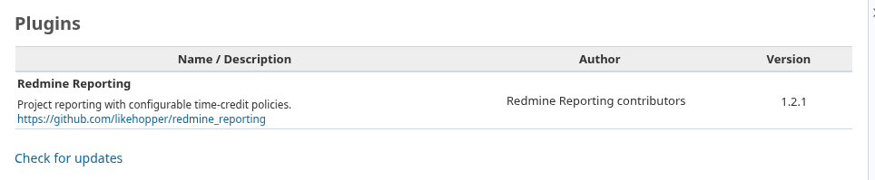

## 2. Grant the permissions

`Administration → Roles and permissions → <role>`, **Reporting** block:

- **View reporting**: open the dashboard;
- **Configure reporting**: edit the project's reporting settings and credits.

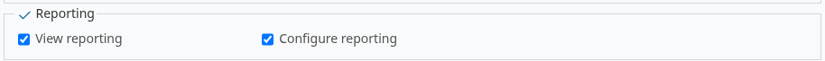

Charts also need Redmine's own permissions: *View issues* for issue charts, *View spent
time* for time charts.

## 3. Enable the module

`Project → Settings → Project`: tick **Reporting** under **Modules**, then save.

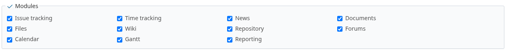

The **Reporting** tab appears in the project menu.


## 4. Configure the reports

`Project → Settings → Reporting`. By default, only **Run** is displayed, every tracker
counts, and a day is 8 hours.

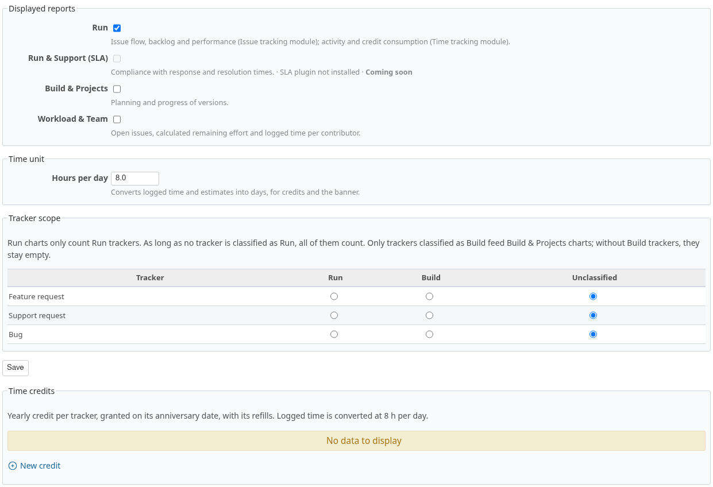

- **Displayed reports**: the dashboard's report families. *Run & Support (SLA)* is not available yet.
- **Hours per day**: converts hours into days.
- **Tracker scope**:
  - Once a tracker is **Run**, Run reports and credits count only Run trackers.
  - Build reports count only **Build** trackers.
  - Workload counts every tracker.

The example enables every family, uses 7.5-hour days, and classifies *Bug* and *Support
request* as Run and *Feature request* as Build.

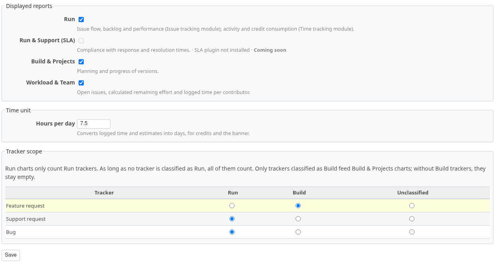

## 5. Add a time credit

In **Time credits**, click **New credit**. The policy below grants 20 days every January 1,
from this year, plus 5 days every July 1.

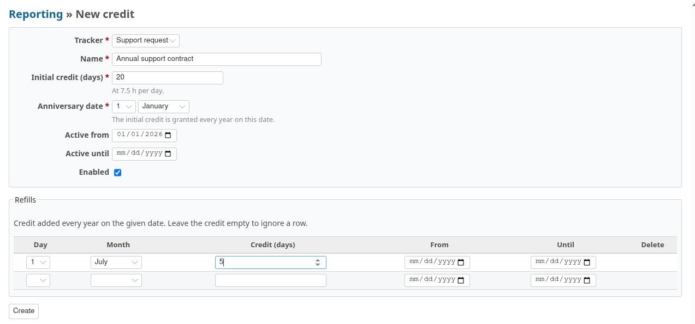

Time logged on the chosen tracker is charged to the credit. Time logged before **Active
from** is not charged.

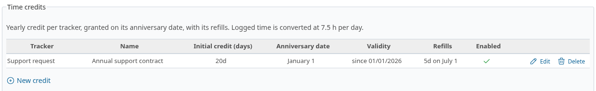

## 6. Subprojects

A subproject without its own settings uses its parent's. Saving the tab gives it its
own settings. Credits are never inherited: each project has its own.

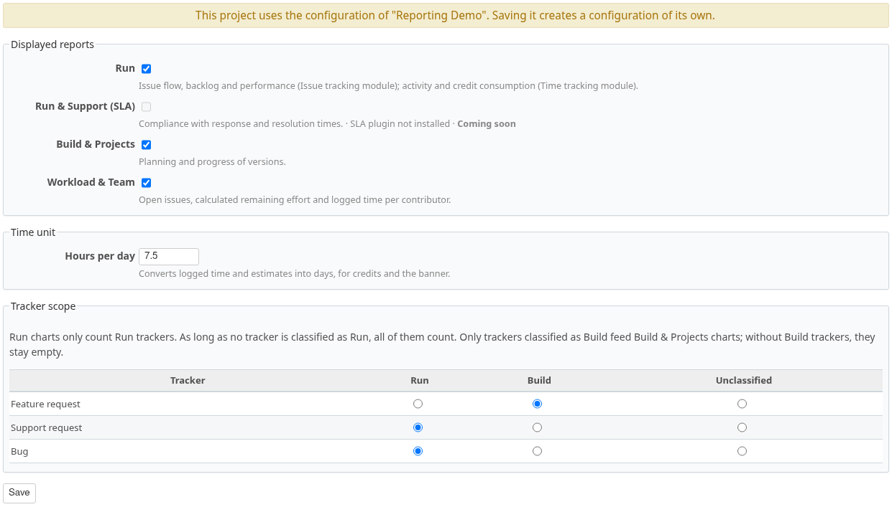

## 7. Read the dashboard

Open **Reporting**. Choose a family tab, Redmine's native **Filters**, and the period and
grouping in **Options**.

### Run

The banner gives the period's issues and work: estimated, done, left to do.

**Issue flow**: issues created and closed per period.

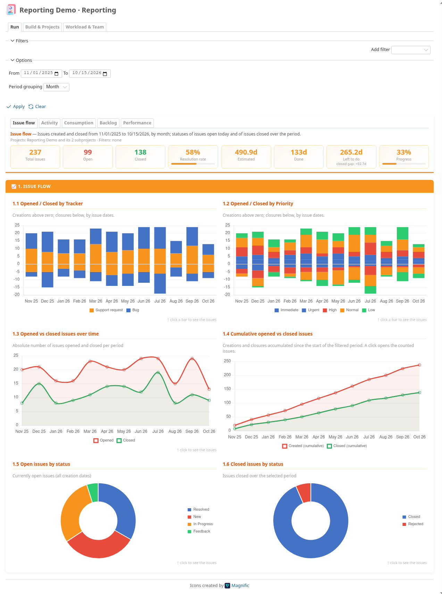

**Activity**: time logged per collaborator and activity.

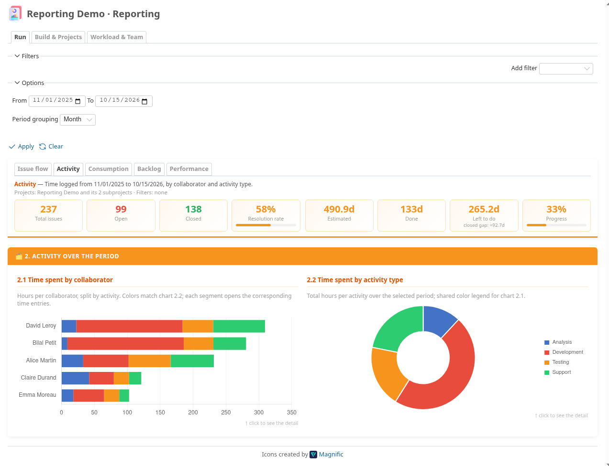

**Consumption**: credit at the start of the period, granted, consumed and left, for the
project and each subproject. *Product* has no Run credit: its only policy is on *Feature
request*, which is Build.

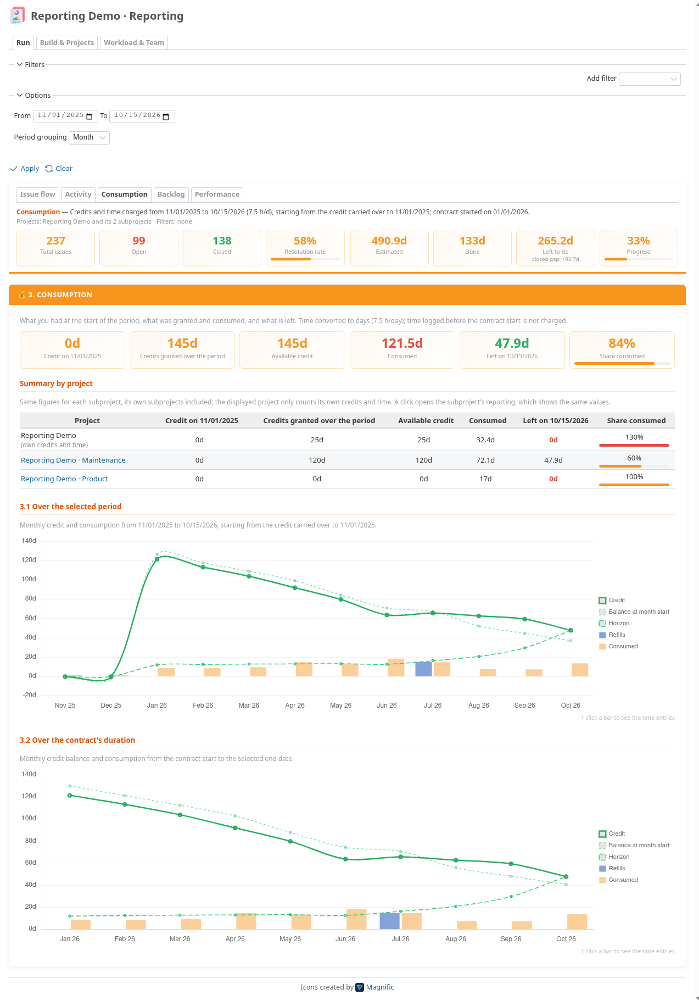

**Backlog**: issues still open at the end of each period, and the time left.

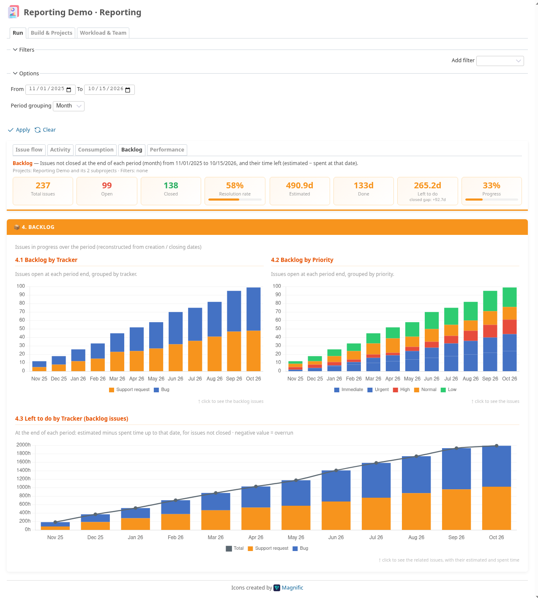

**Performance**: velocity, resolution time and age of open issues.

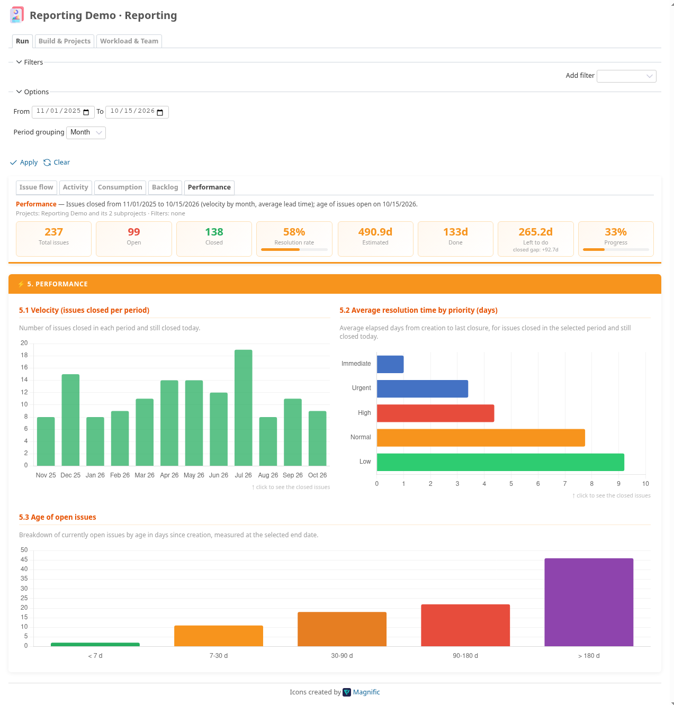

### Build & Projects

Progress, overdue issues and effort by version, then burnup by version.

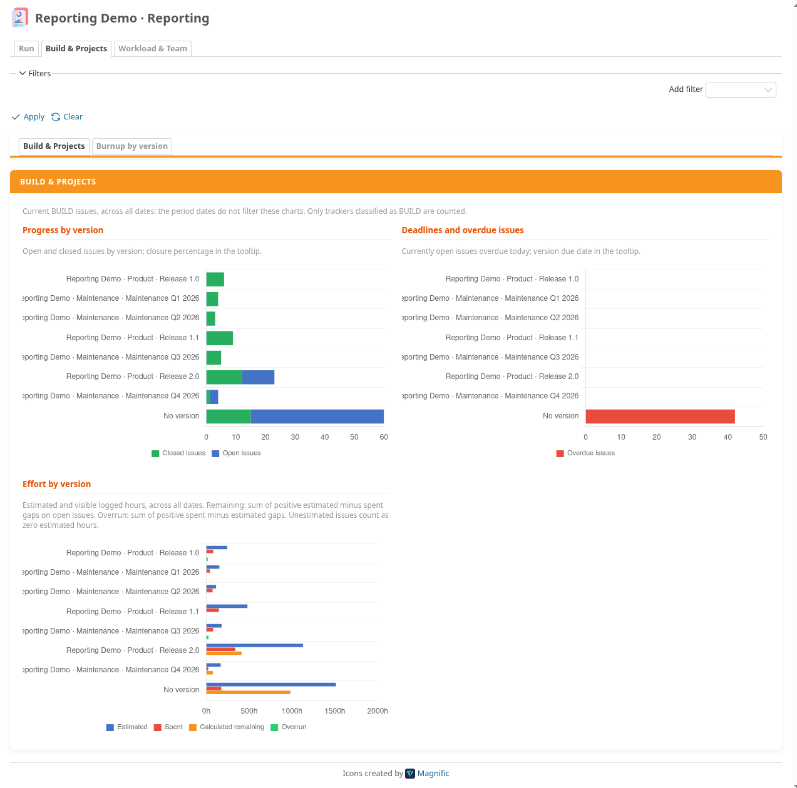

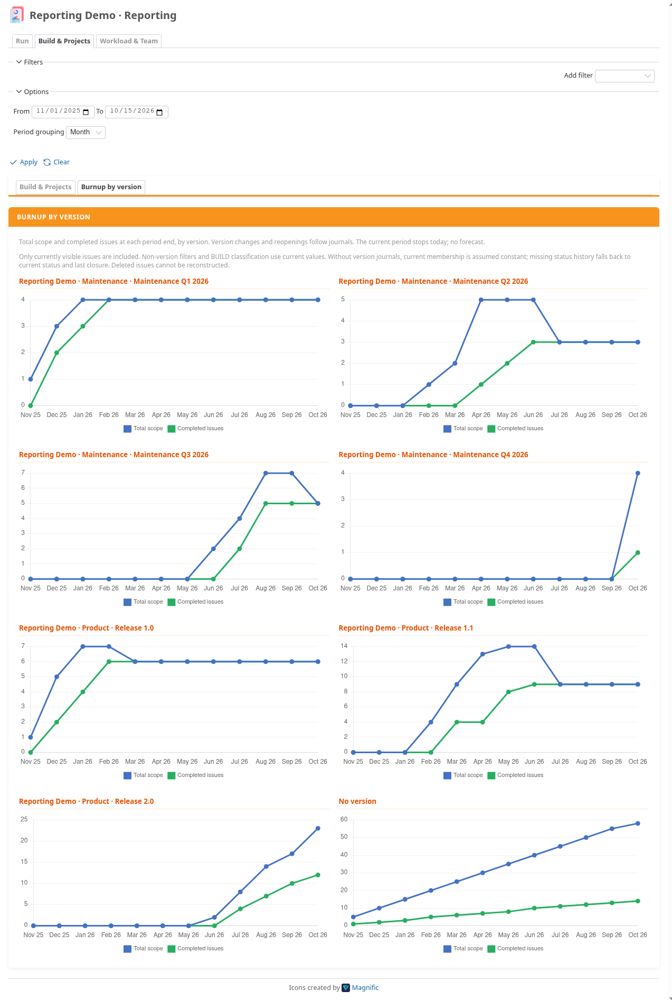

### Workload & Team

Open issues and remaining effort by assignee, and time logged per contributor.

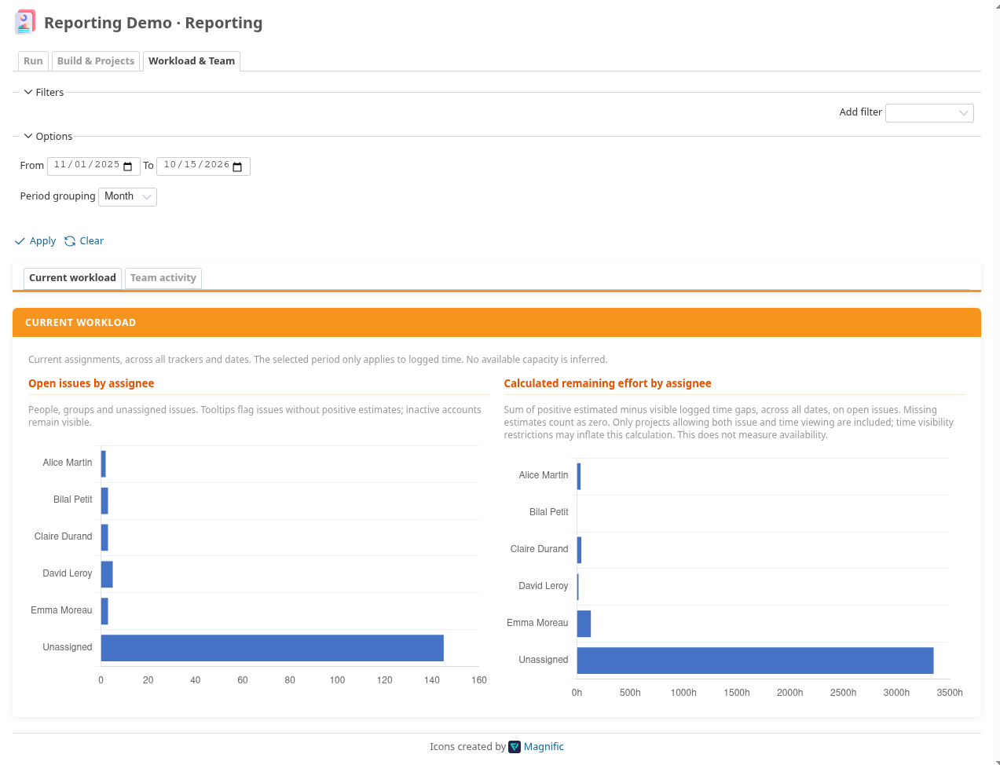

## 8. Open the matching issues

A click on a bar, point, period label or banner figure opens the matching native Redmine
list, already filtered. There you can sort, export or save it as a query.

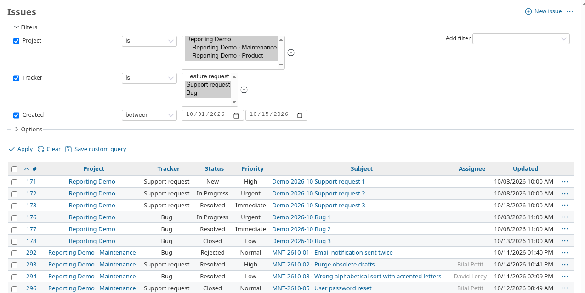

## Troubleshooting

| Symptom | Check |
|---|---|
| No **Reporting** tab | Step 3, then *View reporting* (step 2). |
| No **Reporting** settings tab | *Configure reporting* (step 2). |
| "No report is enabled for this project." | Select at least one family (step 4). |
| Activity or Consumption tab missing | *Time tracking* module and *View spent time*. |
| Issue tabs missing | *Issue tracking* module and *View issues*. |
| Build & Projects empty | Classify at least one tracker as Build (step 4). |
| Credit at 0 days | The credit's tracker is not Run, its validity does not cover the period, or it is disabled. |

## Regenerating the screenshots

```sh
bash test/documentation/run.sh [6.0.11|6.1.4|7.0.1]
```

This runs the test in a disposable container (SQLite, Chromium, default 6.1.4). It
updates `doc/screenshots/configuration/` and the README image. Figures depend on the
run date. The test is not part of `redmine:plugins:test`.
